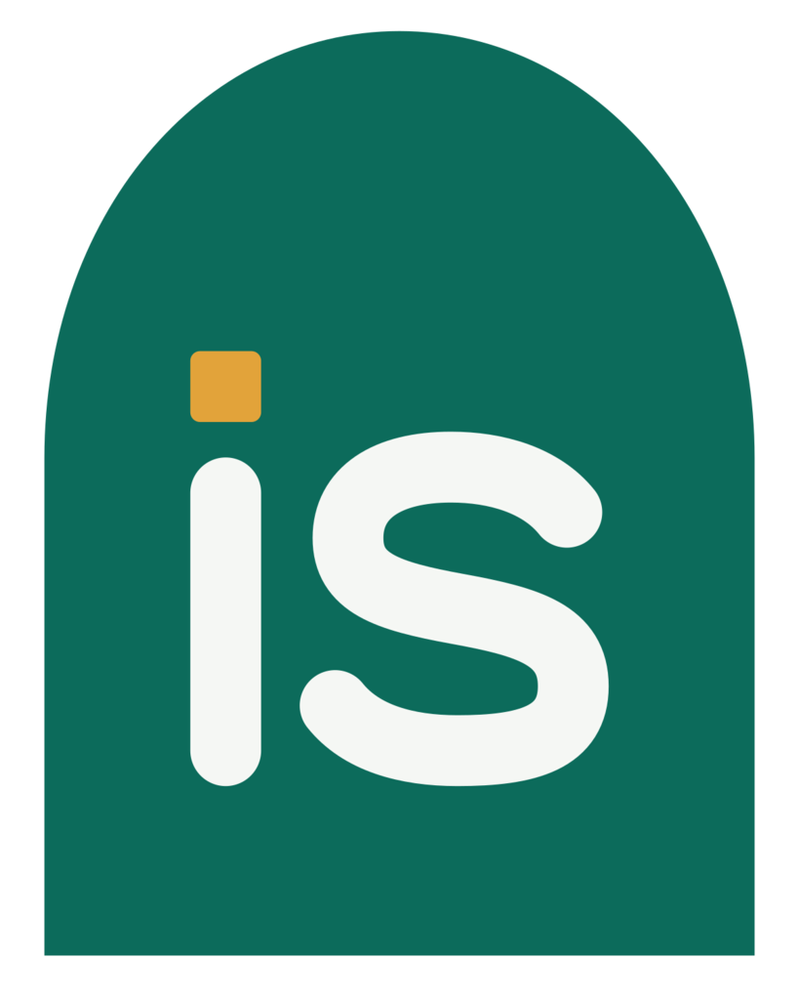
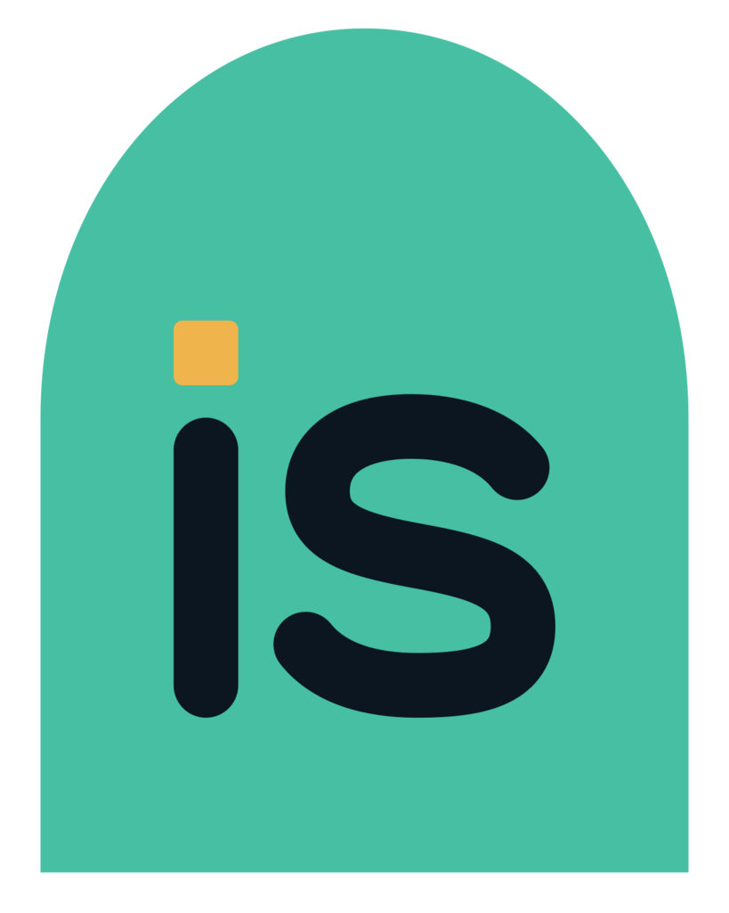
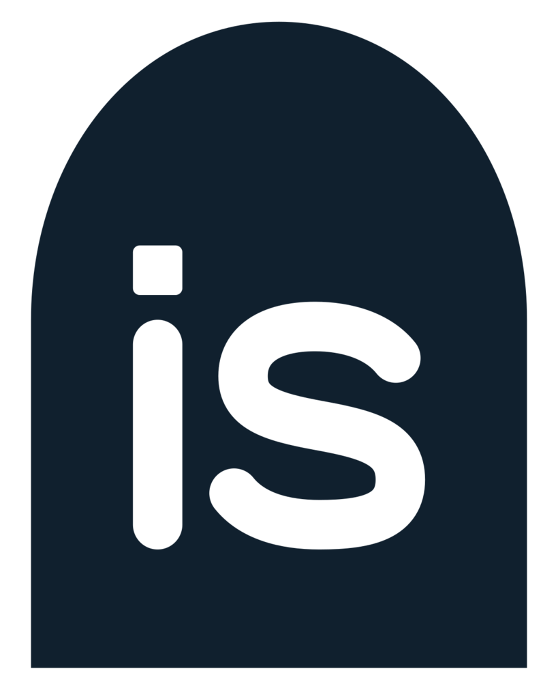
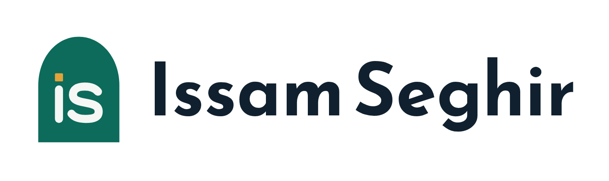
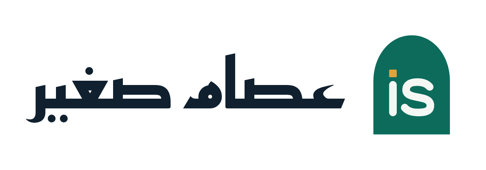
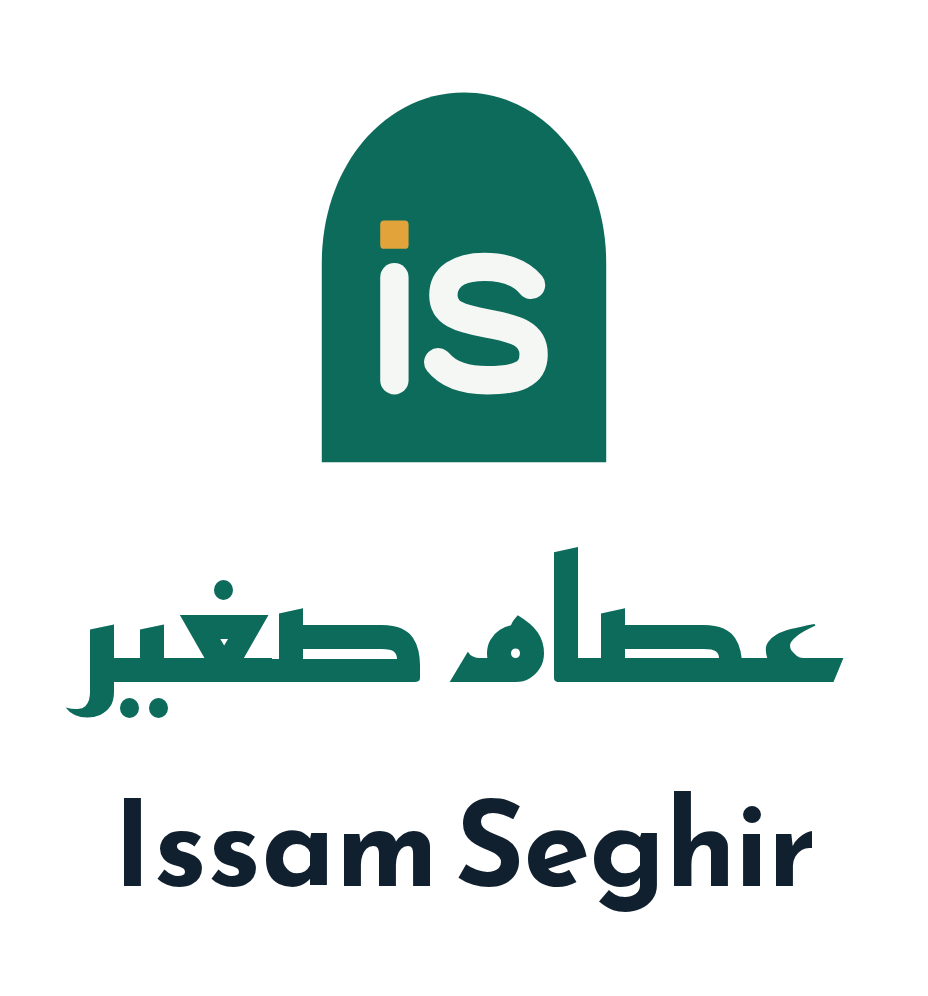

# Issam Seghir Brand Book · عصام صغير

**Software engineer and SaaS founder in Algiers.** I design and build products from the first sketch to launch day.

> «كن عصامياً، ولا تكن عظامياً»
>
> Be self-made like ʿIṣām, not proud of your ancestors' bones. Arab proverb, in al-Maydānī's _Majmaʿ al-Amthāl_.

The same brand book as a page: [brand-kit/issam-seghir-brand-book.html](brand-kit/issam-seghir-brand-book.html) (published at https://claude.ai/artifact/SqyMNWrw2f6tHXTQ6DmfeG); as a PDF: [brand-kit/issam-seghir-brand-book.pdf](brand-kit/issam-seghir-brand-book.pdf). The rules behind it are in [brand.md](brand.md). October 2026.

---

## The name: a word for the self-made

This is a personal brand, so the name is fixed. What the brand chooses is which of its meanings to stand on. In Arabic, ʿIṣām is the man the word عصامي comes from: the everyday word for someone who made himself without inherited rank. For a self-taught engineer who founded his own products, the meaning is already the pitch.

|          |                                                                  |
| -------- | ---------------------------------------------------------------- |
| Arabic   | عِصام صغير                                                       |
| Latin    | Issam Seghir · say it ee-SAAM se-GHEER                           |
| Root     | ع ص م: to hold fast, to protect                                  |
| The word | العِصام: the tie of a water-skin, and the strap it is carried by |
| Derived  | عِصامي: self-made                                                |

**The spelling.** "Issam" is the usual Maghreb transliteration; "Seghir" is the Algerian civil-register spelling of صغير. Both match the GitHub handle `issam-seghir`.

### Addresses

| Domain            | Use               | State on 20 October 2026       |
| ----------------- | ----------------- | ------------------------------ |
| `issam.tech`      | main              | yours, live on Vercel          |
| `issamseghir.com` | optional redirect | free                           |
| `issam.dev`       | none              | someone else's; never print it |

Trademarks are not checked.

---

## In the classical sources

All from al-Maydānī, _Majmaʿ al-Amthāl_, proverb no. 4189 (vol. 2, p. 331).

> نَفْسُ عِصَامٍ سَوَّدَتْ عِصَاماً

ʿIṣām's own spirit made ʿIṣām a chief. Al-Maydānī names him as ʿIṣām ibn Shahbar, chamberlain to the king al-Nuʿmān ibn al-Mundhir.

> كن عصامياً، ولاَ تكن عظامياً

Be ʿiṣāmī, self-made, and not ʿiẓāmī, someone who boasts of ancestors who are now only bones.

> يضرب في نَبَاهة الرجل من غير قديم … يعنى أنه خرج بنفسه من غير أولية كانت له

Said of a man who becomes distinguished without an old lineage: he rose by himself, with no inherited start.

> فإنِّي لاَ ألُومُكَ في دُخُول … وَلَكِنْ مَا وَرَاءَكَ يا عِصَامُ؟

I don't blame you for barring the door; but what news is behind you, ʿIṣām? Al-Nābigha al-Dhubyānī, when ʿIṣām kept him from the sick king's door. ʿIṣām was the keeper of a door, which is where the mark comes from.

> نَفْسُ عِصَامٍ سَوَّدَتْ عِصَامَا … وَعَلَّمَتْهُ الكَرَّ وَالإقْدَامَا

ʿIṣām's spirit made ʿIṣām a chief, and taught him to charge and press forward. Given with «وقيل», no poet named; later anthologies attribute it to al-Nābigha. Vowels normalised from the digital edition; check a printed copy before print.

---

## Why it works

- **It's a person.** Clients hiring a freelancer hire a person, not a studio.
- **Self-made is in the word.** Arabic speakers already know عصامي, and the story of a self-taught founder is told before the About page.
- **The keeper of the door.** ʿIṣām ibn Shahbar kept a king's door; the portfolio is the door to the work, and the mark is drawn as that doorway.
- **To hold fast.** The root means to hold and protect; the ʿiṣām carries the water. Carrying a project to launch is the job.
- **The dot.** The saffron square is the dot of the i, a full stop and a cursor. It marks things that are finished.
- **Two scripts, one name.** Natural in Arabic and Latin, short, nothing added.

---

## The mark

&nbsp;&nbsp;
&nbsp;&nbsp;
&nbsp;&nbsp;

Default · inverse · dark mode · one colour.

Everything is measured in the dot (d), the saffron square. The doorway is 10d wide; its straight jambs rise 7d to the spring line and the arch rises 6d more, so the opening is taller than a half-circle. The letters are drawn with a 1d stroke, 2d in from each jamb. Clear space is 2d; the smallest size is 16 px. The HTML page shows the construction lines and animates the drawing.

**Never:** stretch or rotate it; fill it with a gradient or another hue; use it as an outline; put it on a busy photo without a plain plate; swap the drawn letters for a font.

---

## Lockups

The mark sits where reading starts: left of the Latin name, right of the Arabic one, 2d apart.

---

## Colour

| Name             | Light     | Dark      | Role                          |
| ---------------- | --------- | --------- | ----------------------------- |
| Limewash / Night | `#F5F7F4` | `#0B1620` | Page ground                   |
| Ink              | `#10202E` | `#E8EEEC` | Text and headings             |
| Stone            | `#55636B` | `#9AA9AE` | Secondary text                |
| Zellige          | `#0C6B5B` | `#46BFA3` | The only brand colour         |
| Saffron          | `#E2A33A` | `#F0B44C` | The dot and status, as a fill |
| Casbah blue      | `#2F5D8A` | `#7FA8D6` | Links in long text            |

Taken from Algiers: limewashed walls, zellige tile, saffron, and the blue of the bay. Every text pairing passes WCAG AA in both themes (ratios in [brand.md](brand.md)).

---

## Typography

| Face           | Job                                | Sample                                                                              |
| -------------- | ---------------------------------- | ----------------------------------------------------------------------------------- |
| Reem Kufi      | Display, headings, wordmark        | I build products people use · أبني منتجات يستخدمها الناس                            |
| Readex Pro     | Interface and body in both scripts | Ecomenia handles orders, delivery and inventory for sellers who run several stores. |
| JetBrains Mono | Code and commands                  | `pnpm db:migrate`                                                                   |

---

## Voice

| Say                                                                                                                                                                       | Not                                                  |
| ------------------------------------------------------------------------------------------------------------------------------------------------------------------------- | ---------------------------------------------------- |
| I built the storefront and admin for a shopping platform used by more than 3 million people. · بنيت واجهة المتجر ولوحة الإدارة لمنصة تسوّق يستخدمها أكثر من 3 ملايين شخص. | I craft stunning, pixel-perfect digital experiences. |
| Tell me what you're building. · أخبرني بما تبنيه.                                                                                                                         | Let's build something amazing!                       |
| Taking new projects from December. · أستقبل مشاريع جديدة ابتداءً من ديسمبر.                                                                                               | 🚀 Open to exciting opportunities!                   |
| This page didn't load. Try again, or email me. · لم تُحمَّل الصفحة. أعد المحاولة، أو راسلني عبر البريد.                                                                   | Oops! Something went wrong 😢                        |

---

## Source of truth

- Rules and reasons: [brand.md](brand.md). Files: [brand-kit/](brand-kit/README.md).
- Mark: `src/components/ui/logo.tsx`, `public/images/brand/logo-mark.svg`, `public/favicon.svg`.
- Colour tokens: `src/styles/globals.css`. Fonts: `src/app/[locale]/layout.tsx`.

Limits: trademarks not checked; verse vowels normalised from a digital edition; a designer's review of the mark is welcome before print.
